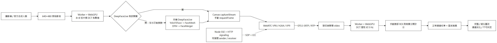
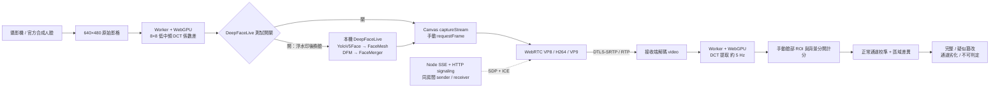
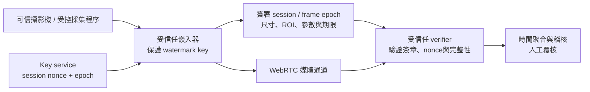

# WebRTC 視訊浮水印系統

依 `readme-watermark.txt` 建置的實驗原型。公開包只包含現行 WebRTC 浮水印與來源簽章程式。

本版可執行像素浮水印、真正 WebRTC 編解碼、區域完整性檢測，以及 **DeepFaceLive 官方模型的實際換臉測試**。它驗證「嵌入浮水印後的像素是否仍保留訊號」，不認證攝影機來源、身分或活體。

## 架構與資料流



[可縮放 SVG](docs/images/architecture.svg)



可選「浮水印之前換臉」：來源 → DeepFaceLive → 嵌入浮水印 → WebRTC。這是必要的負控制，用來展示信任邊界；此路徑仍可能顯示浮水印完整。

### API 與原文件的修正

`RTCRtpScriptTransform` / Encoded Transform 操作**編碼影格**，不能當作原始像素 DCT 接口。[W3C Encoded Transform](https://www.w3.org/TR/webrtc-encoded-transform/) 與 [Media Capture Transform](https://www.w3.org/TR/mediacapture-transform/) 是不同層的 API。原始影格路徑可以用 `MediaStreamTrackProcessor` / `VideoTrackGenerator`，但不同瀏覽器的接口位置與可用性需要 feature detection。

本版落實文件也允許的 **Canvas 相容路徑**：來源 video → OffscreenCanvas staging → ImageBitmap 交給 Dedicated Worker → WebGPU compute → Canvas captureStream → WebRTC。接收端從已解碼 video 取得 ImageBitmap，不修改 RTP 位元組。UI 不在主執行緒做 DCT；GPU 不可用時明確失敗，不以假的檢測結果替代。

### 浮水印寫入公式

每個 8×8 區塊的亮度為 `Y = 0.299R + 0.587G + 0.114B`。只計算兩個非 DC 的低中頻係數 `A=C(2,1)`、`B=C(1,2)`；其正交基底為：

```text
φ(u,v,x,y) = 0.25 cos((2x+1)uπ/16) cos((2y+1)vπ/16)
s = session sequence 的區塊符號（+1 或 -1）
δ = s · max(0, α - s(A-B)) / 2
Y′(x,y) = Y(x,y) + δ[φ(2,1,x,y) - φ(1,2,x,y)]
```

修改 RGB 三通道相同增量，回到 uint8 時做 rounding/clipping。這等效於僅調整兩個 DCT 係數，不必完成 64 個係數的完整 DCT/IDCT。預設強度 `α=36`，可調 8～100；強度增加會提高可見失真，不能保證肉眼完全不可見。

接收端重新計算 `s(A-B)`；正值代表該區塊 bit 正確。區域分數是 **bit agreement**，不是人臉真實機率或安全信心值。每個實驗以 `crypto.getRandomValues` 建立 32-bit seed，區塊序列使用可重現整數混合。**目前序列不是 cryptographic PRF，seed 會交給瀏覽器與實驗 JSON，不具對抗惡意發送端的金鑰保密性**。

### 完整性狀態

1. 正常來源採集 30 個解碼樣本建立臉部與背景基準；兩者平均皆至少 80% 才允許判定。
2. 背景低於 `max(75%, baseline.background − 12%)`：`channel_degraded`，可能是壓縮、失去同步或全畫面修改，不能斷言換臉。
3. 背景合格，但臉部低於 `max(70%, baseline.face − 18%)`：`suspected_tamper`。
4. 其他為 `watermark_intact`；未校準、ROI 無效、尺寸不是 640×480、GPU 失敗皆不可認證。

ROI 為手動框選，不是人臉 landmark 偵測。門檻是原型啟發式，尚未用代表性資料校準誤報／漏報率；文件所述「85%」不是通用標準，也沒有「AI 絕對不可能複製浮水印」的保證。

## 落地實務的兩個痛點與解法

|痛點|本版落實的解法|驗證與邊界|
|---|---|---|
|WebRTC 有損壓縮會抹除 LSB、小訊號|8×8 低中頻 DCT 係數差；每區塊重複一個 keyed bit；正常通道校準；ROI／背景差異；codec、強度與位元率可調|實際 Chrome VP8/H264/VP9、2 Mbps 保留率接近 100%；H264 300 kbps、強度36 不足以校準，系統拒絕給通過。下一步應提高 bitrate／強度並重校準，或降低解析度後重建區塊同步；不能聲稱任意壓縮皆可抵抗。|
|JavaScript 逐影格 DCT 使 CPU、延遲與佇列失控|WGSL WebGPU compute；每 workgroup 處理一個區塊；Dedicated Worker；發送逐影格串行，接收約5Hz；一次只處理一張、不堆積佇列；保留 CPU reference 供數學驗證|正常 640×480 約30FPS、嵌入/提取 p95 <11ms；有像素 readback 成本。DeepFaceLive 換臉回路約11FPS，不能把浮水印耗時與整條換臉管線耗時混為一談。|

實測發現 WebRTC 在低速來源下會自動降解析度，所以設定 `contentHint='detail'` 與 `degradationPreference='maintain-resolution'`；仍在接收端檢查實際解碼尺寸。現行沒有縮放／裁切／旋轉的浮水印同步搜尋、FEC、動態 strength 控制或 WASM fallback。

生產擴充：GPU texture 全程留在 GPU、避免 CPU readback；以 Raw VideoFrame processor/generator 替換 Canvas；將低中頻訊號加入交錯、BCH/LDPC FEC 與 pilot；依 codec/QP/解析度建立可靠的參數 profile；伺服器驗證每區域與連續多影格門檻。這些是後續設計，不能視為已實作。

## 啟動與使用

```powershell
npm start
```

開啟 [http://localhost:8788](http://localhost:8788)。Node 預設只綁 `127.0.0.1`；不需要 npm runtime 套件。Chrome/Edge 須支援 WebGPU、OffscreenCanvas 與 Canvas captureStream。相機權限需 localhost 或 HTTPS。

### 一鍵 DeepFaceLive 驗證

1. 模式選「本機雙 PeerConnection」，來源選「DeepFaceLive 官方合成人臉測試圖」；先關閉 DeepFaceLive 開關。
2. 對官方測試圖設 ROI：`x=.375, y=.25, w=.25, h=.5`。選 VP8、2000 kbps、強度36。
3. 啟動，等待畫面稳定後按「正常通道校準」，約6秒，看到「浮水印完整」。
4. 打開 **DeepFaceLive 測試開關**；系統停止原串流但保留基準。換臉時點選「浮水印之後」，再啟動。真正官方模型處理過的像素會進入 WebRTC，正常應顯示「疑似區域篡改」。開始時通道尚未收斂，可能短暫顯示通道劣化。
5. 停止，改成「浮水印之前」，再啟動；即使外觀已換臉，完整性仍可能通過。這證明可信採集／嵌入點是架構必要條件。

實際相機亦可選「攝影機」，將臉置於 ROI。無臉時 DeepFaceLive 回報 `no_face`，不算成功換臉；相機影格不落盤，只有明確按錄製才下載影片。`局部破壞` 只是合成矩形覆蓋測試，不是 DeepFaceLive。

開關不會結束桌面 DeepFaceLive 視窗或已載入模型服務；它控制視訊路徑。按「啟動 DeepFaceLive」可開桌面軟體；Web UI 的換臉測試直接使用同一套官方 backend / DFM / FaceMerger 程式碼，無需先手動接 OBS。

### DeepFaceLive 安裝與模型

- 程式：`.local/DeepFaceLive/`，官方 commit `fc7b787bda2b8c186e142c52857458eea3a935ed`。
- 隔離環境：`.local/dfl-env/`，Python3.10，`onnxruntime-directml`；此環境不隨公開包提供。
- 模型：`.local/dfl-userdata/dfm_models/Rob_Doe.dfm`，來源為[官方 release](https://github.com/iperov/DeepFaceLive/releases/download/ROB_DOE/Rob_Doe.dfm)。使用官方合成角色測試圖；沒有提交真實使用者人臉素材。
- RTX4070 DirectML detector、FaceMesh 與 DFM 推論；FaceMerger 為 CPU。GUI 與所有模型檔保留官方 GPLv3 license；發布／再分發需處理官方軟體與模型各自授權。
- `tools/deepface-requirements.lock.txt` 記錄已安裝套件；`tools/deepface-compatibility.json` 記錄 Python／PyQt 修正。第三方原始碼位於忽略的 `.local/`，未修改全域 Python 或 Windows paging 設定。

重新安裝可用既有 Conda Python3.10 執行 `tools/install_deepface.py`。安裝器鎖定本次已下載檔案的 SHA-256、重用相同 Hash 的快取並保留失敗 partial；這些是本次下載的追溯 Hash，不是官方簽署證明。不要用 Python3.12 的原 `.venv` 安裝舊版 DeepFaceLive。

```powershell
# 直接開啟桌面程式
./.local/dfl-env/Scripts/python.exe tools/launch_deepface.py
# 本機推論服務；Web UI 開啟測試時也會自動啟動
./.local/dfl-env/Scripts/python.exe tools/deepface_service.py
```

服務綁定 `127.0.0.1:8790`，PNG 請求限2MB且固定640×480；請求串行處理，圖像僅存記憶體。Node 提供 `/api/deepface/service`、`/health`、`/swap`、`/start`、`/status`，UI 的啟動與影像 API 有同 origin/header 檢查，但沒有帳號認證。

### 外部 DeepFaceLive / OBS 流程

若要驗證 GUI / OBS 整條鏈：正常錄製 watermarked-input.webm 並匯出設定 → 必要時用 FFmpeg **lossless** 轉 AVI → DeepFaceLive File source 選影片，Detector/Marker/DFM 選 RTX4070、模型 Rob Doe、Stream output 選 Merged frame → OBS Window Capture DeepFaceLive output，canvas/video固定640×480 → OBS Virtual Camera → 本 UI 選「外部輸出（不重新嵌入）」、匯入原設定 → WebRTC 檢測。

此 GUI→OBS→Virtual Camera 路徑尚未實測；本次完成的是官方 backend 實際換臉→WebRTC。若畫面裁切／縮放或 OBS 先壓縮，須做 **不換臉的相同橋接** 負控制，否則不能把浮水印損失全部歸因於換臉。[官方串流文件](https://github.com/iperov/DeepFaceLive/blob/master/doc/windows/for_streaming.md) 提供 Window Capture 或 MPEGTS UDP 路徑。

### 房間與網路

同一伺服器開兩個分頁，使用相同房間名，分別選 sender/receiver。Node SSE 傳 SDP 與完整 ICE candidates，真正媒體仍走 PeerConnection；peer 離線會停止對端。已驗證跨分頁，不代表跨 NAT 已通過。

對外或跨設備需 HTTPS、受驗證的 signaling 身分與房間授權、STUN/TURN credential、ICE restart、斷線恢復及 SFU 方案。現版 `iceServers=[]`，不提供 TURN、TLS 或認證，請勿直接公開本機實驗服務。

## 信任邊界與生產架構



此圖為生產目標；目前瀏覽器 JS 可以被修改、seed 可取得、狀態與基準可偽造，一般瀏覽器路徑沒有可信硬體嵌入器或 KMS。可選的 Windows TPM 路徑已有影像簽章、challenge、序號與摘要鏈驗證，但未完成硬體／程式認證與解碼像素綁定。攻擊者能在虛擬攝影機送出換臉後再添加合法浮水印；受控制的發送端也能重新嵌入。背景對照只能幫助分辨局部破壞與通道劣化，不能排除所有攻擊。

要把「浮水印防篡改」提升為來源證明，必須先建立可信採集與簽章來源；再加每 session/epoch cryptographic PRF、限時 nonce、防重播、attested enrollment、接收端可信 verifier、篡改區域/誤報率驗收。DTLS-SRTP 保護傳輸，無法驗證採集前是否換臉。

## 驗證

```powershell
npm test
node --check public/app.js
node --check public/gpu.js
./.local/dfl-env/Scripts/python.exe -m pip check
# 以下需 Node 8788 已啟動，實際 Chrome/WebGPU 可用；測試串行執行
./.venv/Scripts/python.exe tools/browser_validation.py
./.venv/Scripts/python.exe tools/deepface_browser_validation.py
./.venv/Scripts/python.exe tools/codec_room_validation.py
```

目前驗收結果、實際數值、限制與 evidence 見 [WATERMARK_VALIDATION.md](WATERMARK_VALIDATION.md)。單張合成人臉、單一 DFM 模型與本機網路不能證明泛化防 Deepfake 或生產誤報率。
# DeepFaceLive 啟動修復（2026-10-03）

新增「本機攝影機＋TPM 來源簽章」開關：Windows本機採集、原生DCT嵌入、TPM簽章與挑戰／序號／摘要鏈驗證已實作，實體攝影機WebRTC測試通過。此為本機原型，尚無攝影機硬體／程式認證、FIDO及解碼像素簽章綁定，不能宣稱真人認證。使用與完整限制見 [SOURCE_SIGNING.md](SOURCE_SIGNING.md)。

攝影機顯示「Could not start video source」：請停止其他程式的攝影機輸入，點「更新裝置」並選擇 Integrated Camera。瀏覽器負責採集時，DeepFaceLive GUI 不應同時開啟同一台實體攝影機。更新裝置只枚舉裝置；採集失敗會降低影像限制重試同一台一次，不會偷偷切換攝影機。實體攝影機仍被占用時，網站無法代替其他程式釋放裝置。

請使用 http://localhost:8788/ 並重新整理。已重現原推論工作階段回傳 500，造成自動停止與清空畫面；底層失效原因未確認，重啟後實際換臉恢復。

新增官方人臉圖的模型暖機、例外紀錄、推論失敗後重建一次、JSON 錯誤及前端持續顯示。再次失敗 health 將回報未就緒。校準基準保留，靜態資源停用快取。

回歸：`.venv/Scripts/python.exe tools/deepface_start_validation.py`；新增正式證據 `validation/results/deepface-start-fix.json`。使用者攝影機仍需重測。自動重建尚未以真實 GPU 故障強制驗證。


## 公開原始碼包

新環境安裝與檔案說明見 [INSTALL.md](INSTALL.md) 與 [PUBLICATION.md](PUBLICATION.md)。架構圖為說明用途，TPM 以 SOURCE_SIGNING.md 的實作與限制為準。驗證報告記錄原開發機的歷史結果，並不代表下載後已自動完成驗證。
