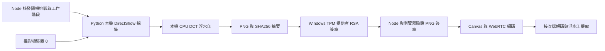

# 本機來源簽章架構與實務限制

2026-10-03 組合啟動修復：TPM＋DeepFaceLive同時開啟已用實體攝影機重測；推論服務不存在時會自動啟動及暖機，傳輸失敗會重試同一張影像一次。原生嵌入模式不再初始化多餘的GPU嵌入Worker。新增證據`validation/results/combined-start-fix.json`，包含正常校準後保留基準及真正模型換臉；約1.8–2FPS。此證據驗證啟動／播放，不保證手動ROI一定偵測到換臉；實測也出現通道劣化及完整判定。

這版新增可執行的本機採集與 TPM 來源簽章原型。它不等同完整的硬體可信採集，也沒有宣稱能辨識所有換臉。

## 使用

開啟 http://localhost:8788/，選「攝影機 → 嵌入浮水印」與「本機雙 PeerConnection」，開啟「本機攝影機＋TPM 來源簽章」後啟動。採集程式固定使用 DirectShow 裝置 0；此機實测對應 Integrated Camera。瀏覽器攝影機選單在此模式不參與採集。其他程式必須先釋放攝影機。

正常畫面穩定後校準。來源簽章模式拒絕 DeepFaceLive 的 before-watermark 選項；after-watermark 仍可作篡改實驗。其他瀏覽器來源及 DeepFaceLive 測試仍保留，且不會被標記為來源已驗證。此版来源簽章只支援本機回路，尚未導入跨房間遠端來源驗證。

## 實際管線

本機採集 API 不接受呼叫者提供的影像，也不提供任意資料簽章端點。Node 以每次程序啟動產生的秘密識別碼呼叫 loopback 採集程式；秘密只放程序環境及記憶體，不寫入檔案或瀏覽器。來源 POST API 必須有同 Origin 及專用標頭，並限制 Host 為 localhost／127.0.0.1，以避免跨網站請求與 DNS rebinding。此為本機實驗授權，尚未實作 FIDO／使用者帳號授权。

簽章涵蓋工作階段、256-bit 隨機挑戰、seed、浮水印強度、影格序號、時間、前一份 manifest 摘要、PNG 摘要、640×480、攝影機 index、採集及浮水印演算法識別。Node 與瀏覽器依序驗證 RSA/SHA256、工作階段、期限、序號／摘要鏈與 PNG 內容。修改、重播、錯誤挑戰、過期或金鑰替換會失敗。

工作階段最長10分鐘；停止會使工作階段失效並釋放攝影機。15秒沒有拉取影格會自動釋放。Node 父程序輸入管線關閉時，本機程式會退出，避免殘留占用。回歸工具不保存攝影機圖片，UI 截圖遮蔽兩個影像區域。

## 金鑰與信任起點

`tools/source_signer.ps1` 使用 Microsoft Platform Crypto Provider 建立／開啟當前 Windows 使用者的持久 RSA2048 金鑰 `WebRTCWatermarkSource-v1`，設定 signing-only 與禁止匯出，並實測私鑰匯出會被拒絕。沒有軟體私鑰 fallback；TPM初始化失敗就拒絕來源簽章模式。

第一次啟動將公鑰登錄至 `.local/source-public-key.json`，後續與之比對；不同公鑰不會自動取代。這是本機首次登錄（TOFU），不是遠端 TPM attestation。私鑰不寫入專案；公鑰檔及日誌已被 `.local/` 忽略規則排除。金鑰保留供之後重啟使用，本工具不會自動删除或輪替。

參考 Microsoft 官方 [CNG 金鑰儲存函式](https://learn.microsoft.com/en-us/windows/win32/seccng/cng-key-storage-functions)、[NCryptSignHash](https://learn.microsoft.com/en-us/windows/win32/api/ncrypt/nf-ncrypt-ncryptsignhash) 與 [公開金鑰匯出](https://learn.microsoft.com/en-us/windows/win32/api/ncrypt/nf-ncrypt-ncryptexportkey)。

## 仍未符合的完整可信採集要求

- 一般攝影機不簽署 sensor 原始資料；DirectShow 裝置 0 與裝置名稱不構成硬體認證。虛擬驅動、惡意驅動或管理員仍可能替換採集內容。
- TPM禁止匯出不代表只有本程式能用金鑰。同一Windows使用者／被入侵端點可能直接呼叫金鑰簽章；尚無程式隔離、code attestation、WDAC政策或受保護採集路徑。
- 簽章驗證的是進入瀏覽器前的 PNG。WebRTC有損壓縮後像素不相同，因此沒有用解碼畫面SHA256比對原PNG，也未提供簽署後視訊的逐影格密碼學綁定。瀏覽器後續可修改Canvas；浮水印完整性與來源PNG簽章是兩種獨立證據。
- 原DCT浮水印不是密碼學MAC，seed已知者可以重新嵌入。來源簽章已通過與浮水印完整均不得解讀成真人或未換臉證明。
- FIDO認證及後端視訊授權、遠端公鑰註冊與TPM認證鏈、端到端已簽編碼影格驗證仍未實作。這些需要另一個驗收階段與實際硬體／企業政策支援，不能只靠新增網頁按鈕補齊。

## 驗證

`node --test` 檢查原浮水印、原生CPU與JS參考結果，以及來源簽章的像素修改、錯誤金鑰、簽章修改、重播、挑戰、期限與摘要鏈。`tools/source_validation.py` 用實體攝影機、TPM及真正Chrome WebRTC測正常校準、停止與before-watermark拒絕；正式結果 `validation/results/source-signing.json`。實測約6.8FPS，尚未達30FPS；原生嵌入p95約16.7ms。
